# Tim Schönle

**Senior Software Developer** based in Germany. Ask me about **Java**, **Spring Boot** and **SQL**.

[](https://tim-schoenle.de) [](https://www.linkedin.com/in/tim-schoenle) [](mailto:contact@tim-schoenle.de)

## Tech Stack

<picture>
  <source media="(prefers-color-scheme: dark)" srcset="assets/tech-stack-dark.svg">
  <source media="(prefers-color-scheme: light)" srcset="assets/tech-stack-light.svg">
  
</picture>

<details>
<summary>Also worked with</summary>

**Languages:** Dockerfile, Markdown, Regular Expressions, TOML<br>
**Frameworks & Libraries:** Bukkit API, Spigot API, next-intl, Zod, shadcn/ui, Lucide React, Pino, Tokio, Yew, Serwist, Express, Webhooks, Octokit, React Query, reqwest, React-PDF<br>
**Infrastructure & Tools:** Cert-Manager, Docker Compose, OpenTelemetry, ExternalDNS, MetalLB, Sealed Secrets, Loki, Tempo, Traefik, OpenEBS, MariaDB, MySQL, Sentry, MinIO, CrowdSec, SQLite, Prometheus, Harbor, Cloudflare Tunnels, AWS S3

</details>

## Weekly Stats

```txt
From: 13 October 2026 - To: 20 October 2026

Total Time: 40 hrs 35 mins

Java                  8 hrs 51 mins    █████░░░░░░░░░░░░░░░░░░░░   21.80 %
Python                3 hrs 47 mins    ██░░░░░░░░░░░░░░░░░░░░░░░    9.31 %
Bash                  3 hrs 3 mins     ██░░░░░░░░░░░░░░░░░░░░░░░    7.51 %
```
