# Tim Schönle

**Senior Software Developer** based in Germany. Ask me about **Java**, **Spring Boot** and **SQL**.

<a href="https://tim-schoenle.de"><picture><source media="(prefers-color-scheme: dark)" srcset="assets/contact-website-dark.svg"></picture></a>
<a href="https://www.linkedin.com/in/tim-schoenle"><picture><source media="(prefers-color-scheme: dark)" srcset="assets/contact-linkedin-dark.svg"></picture></a>
<a href="mailto:contact@tim-schoenle.de"><picture><source media="(prefers-color-scheme: dark)" srcset="assets/contact-email-dark.svg"></picture></a>

## Tech Stack

<picture><source media="(prefers-color-scheme: dark)" srcset="assets/tech-stack-dark.svg"></picture>

Also worked with

**Languages:** Dockerfile, Markdown, Regular Expressions, TOML 
**Frameworks & Libraries:** Bukkit API, Spigot API, next-intl, Zod, shadcn/ui, Lucide React, Pino, Tokio, Yew, Serwist, Express, Webhooks, Octokit, React Query, reqwest, React-PDF 
**Infrastructure & Tools:** Cert-Manager, Docker Compose, OpenTelemetry, ExternalDNS, MetalLB, Sealed Secrets, Loki, Tempo, Traefik, OpenEBS, MariaDB, MySQL, Sentry, MinIO, CrowdSec, SQLite, Prometheus, Harbor, Cloudflare Tunnels, AWS S3

## Weekly Stats

<picture><source media="(prefers-color-scheme: dark)" srcset="assets/stats-dark.svg"></picture>
